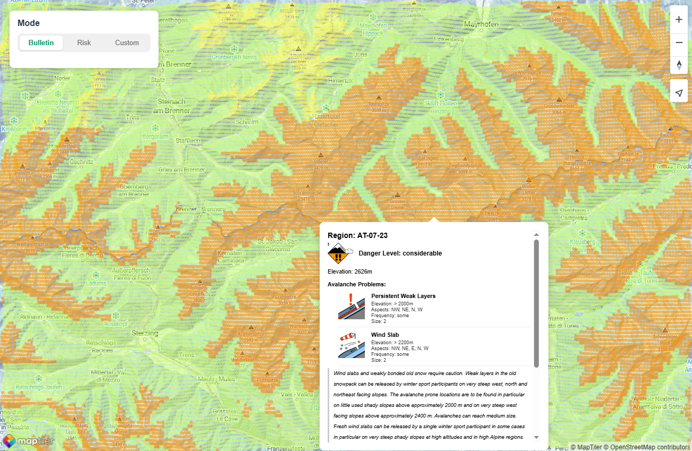
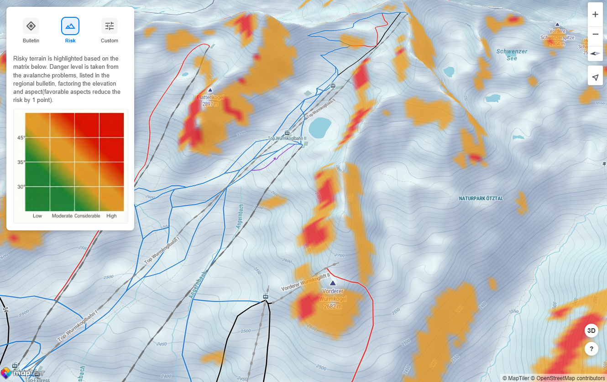
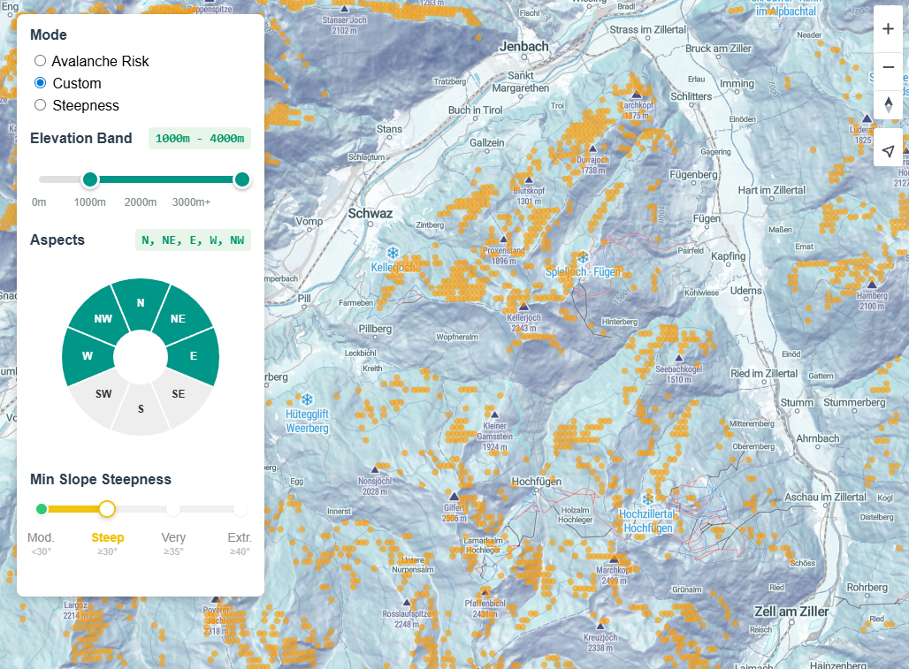

# [AvaAwa.eu](https://avaawa.eu/?utm_source=github)
A tool to assess avalanche terrain, based on the slope parameters and regional avalanche forecast. Key advanage to the tools existing on the market is the highlight of the avalanche danger not only based on the region, but also considering the aspect and elevation relevant to the avalanche problems, specified in the bulletin. The information on the specific problems is avaiiable at a glance, looking at a particular route you are planning.





## Features
- **Avalanche Bulletin Mode**: Fetches and displays real-time avalanche danger levels from official bulletins
- **Risk Mode**: Highlights risky terrain, as per the regional avalanche bulletin, based on the following parameters of the relevant problems(see the matrix in the popup):
  - Danger level
  - Elevation range
  - Aspect
  - Steepness

- **Custom Mode**: Interactive tools to filter terrain based on:
  - Elevation range (min/max)
  - Slope angle(>30°, >35°, >40°)
  - Aspect 

**Disclaimer**: This tool is for informational purposes only. It does not replace official avalanche bulletins or professional danger assessments. You are solely responsible for your safety; entering the backcountry involves significant risk.

## Tech Stack

- **Framework**: [Vite](https://vitejs.dev/) + [TypeScript](https://www.typescriptlang.org/)
- **Backend**: [Node.js](https://nodejs.org/) + [Express](https://expressjs.com/)
- **Core Logic**: Kotlin Multiplatform (KMP). The core avalanche logic and libraries are taken from [ava_android](https://github.com/rocasspb/ava_android) and compiled to WebAssembly (Wasm).
- **Map Engine**: [MapTiler SDK](https://docs.maptiler.com/sdk-js/)
- **Data Fetching**: Axios
- **Data Sources**: 
  - Avalanche Bulletins: 
  1. [avalanche.report](https://avalanche.report)
  2. [SLF](https://slf.ch)
  - Region Boundaries: [regions.avalanches.org](https://regions.avalanches.org)

## Getting Started

### Prerequisites

- Node.js (v16 or higher)
- A MapTiler API Key (configure in `src/main.ts` or `.env` if applicable)

### Installation

The shared Kotlin/Wasm logic is a private package, `@rocasspb/avaawa-shared`, hosted on GitHub Packages.
Create a classic GitHub personal access token with the `read:packages` scope and expose it as `NPM_TOKEN`
(the repo's `.npmrc` reads it). Publishing a new version: push a tag `shared-vX.Y.Z` in `ava_android`.

1. Clone the repository.
2. Install dependencies:
   ```bash
   npm install
   ```

### Running the App

Start the development environment (Backend API + Frontend):
```bash
npm run dev
```

Build and run for production:
```bash
npm run build
npm run server
```

## Developing with the shared library locally

Published versions come from GitHub Packages. To work on the Kotlin code and the web app together, run Vite
against the sibling `ava_android` checkout instead (expected at `../AvaAwaAnd`, override with `LOCAL_SHARED_DIR`):

```bash
# in ava_android: rebuild the Wasm development library on every Kotlin change
./gradlew :shared:wasmJsBrowserDevelopmentLibraryDistribution -t

# in ava_gem
npm run dev:linked
```

`package.json`, the lockfile and `node_modules` are not touched. Plain `npm run dev` uses the published version.

## Updating to a new shared library version

1. In `ava_android`, tag the tested commit and push it: `git tag shared-vX.Y.Z && git push origin shared-vX.Y.Z`.
   The `publish-shared` workflow builds and publishes `@rocasspb/avaawa-shared@X.Y.Z`.
2. Here: `npm install @rocasspb/avaawa-shared@X.Y.Z`, then `npm test`, `npm run build` and check the app.
3. Commit `package.json` and `package-lock.json` together, then run `update.sh` on the server.
   To roll back, revert that commit and deploy again.

## Configuration

Key application settings can be found in `src/config.ts`, including:
- Map defaults (center, zoom)
- Visualization colors and thresholds
- Grid generation parameters
- API endpoints
